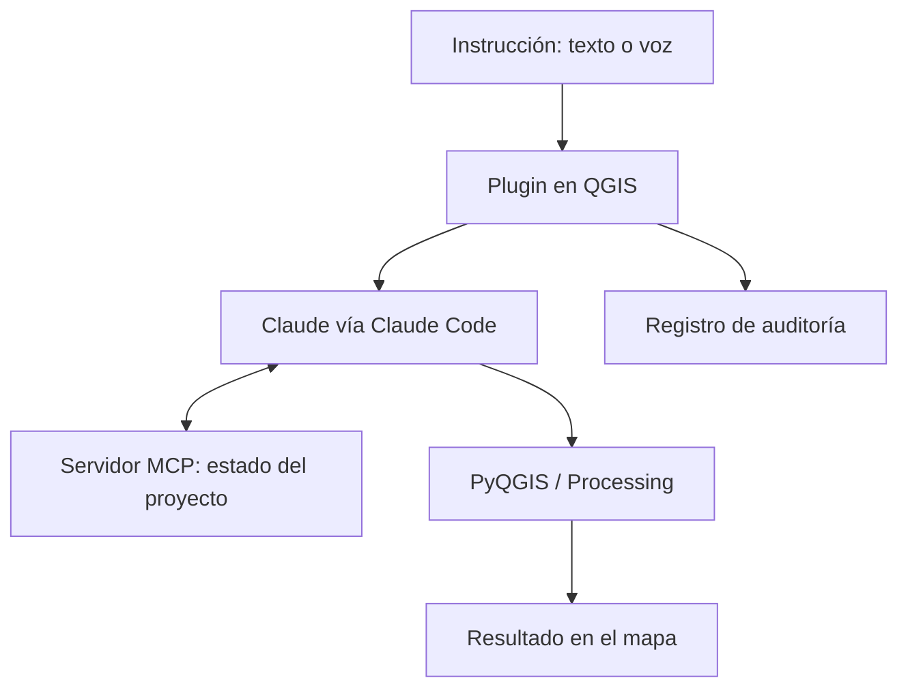

# Agente-LINKAPSIS-QGIS

Asistente de IA dentro de QGIS: el usuario escribe o dicta lo que necesita y el agente lo ejecuta en el proyecto.

> 🔒 Código privado. Este repositorio solo describe el proyecto; no incluye código, datos reales ni credenciales.

## Qué hace
- Recibe instrucciones en texto o por voz (dictado local con Whisper).
- Las resuelve con Claude, usando Claude Code como puente.
- Ejecuta PyQGIS y algoritmos de Processing sobre el proyecto abierto.
- Consulta el estado del proyecto (capas, campos, selección) a través de un servidor MCP propio.
- Deja un registro local de cada acción, encadenado con hashes y con los secretos ocultos.

## Por qué
Muchas tareas GIS repetitivas requieren saber qué algoritmo usar o escribir scripts. El objetivo es que cualquier persona del equipo pueda pedirlas en lenguaje natural y que quede trazabilidad de lo que se hizo.

## Cómo funciona

## Tecnologías
Python · PyQGIS · QGIS Processing · Claude · Model Context Protocol (MCP) · Whisper

## Validación
| Prueba | Resultado |
|---|---|
| Pruebas automáticas en QGIS 3.44 | 42 |

## English
AI assistant inside QGIS: users type or dictate a task and the agent runs it on the open project using Claude, PyQGIS/Processing and a custom MCP server, with a local hash-chained audit log. Source code is private.

---
Tito Ruiz Haros · [github.com/titoruizh](https://github.com/titoruizh)
