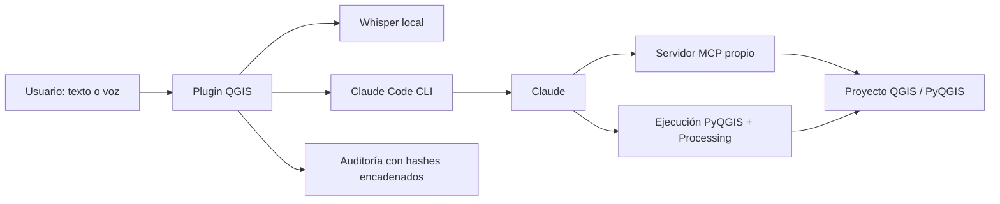

# Agente-LINKAPSIS-QGIS

**Agente de IA que opera QGIS en lenguaje natural con Claude**

> 🔒 **Código privado.** Este repositorio es un *showcase*: documenta el problema, la solución y la arquitectura. El código fuente pertenece a un proyecto profesional y no se publica. No incluye datos reales, credenciales ni información de clientes.

> **Créditos:** fork de [Mapsuke](https://github.com/MIERUNE/mapsuke) (MIERUNE Inc.), licenciado bajo **GPL-2.0**. Este trabajo extiende el plugin original; se mantiene la atribución y licencia del proyecto base.

## English summary
A QGIS plugin (fork of Mapsuke by MIERUNE, GPL-2.0) that lets users operate QGIS in natural language through Claude (via Claude Code): free-form PyQGIS execution, a catalog of Processing algorithms, a custom MCP server, local Whisper dictation and a hash-chained audit log. Verified with 42 tests in real QGIS.

## Problema
Muchas tareas GIS repetitivas exigen conocer cientos de algoritmos de Processing y escribir PyQGIS. Los usuarios no programadores pierden tiempo y los procesos no quedan auditados.

## Solución
- Chat dentro de QGIS conectado a **Claude** mediante **Claude Code**.
- Ejecución de **PyQGIS** con helpers propios y acceso a un catálogo de **~5.400 algoritmos de Processing**.
- **Servidor MCP propio** (stdio) para que el modelo consulte el estado del proyecto.
- **Dictado por voz local** con Whisper.
- Contexto adicional: dibujos y adjuntos sobre el mapa.
- **Auditoría local** con hashes encadenados y redacción automática de secretos.

## Arquitectura

## Stack
PyQGIS · Python · Claude (Claude Code) · MCP · Whisper · QGIS Processing

## Métricas verificadas
| Indicador | Valor |
|---|---|
| Pruebas en QGIS real | 42 |

## Capturas
<!-- TODO: captura del panel del agente en QGIS con capa de ejemplo -->

## Licencia
GPL-2.0, heredada de Mapsuke (MIERUNE).

## Autor
Tito Ruiz Haros · [github.com/titoruizh](https://github.com/titoruizh)
